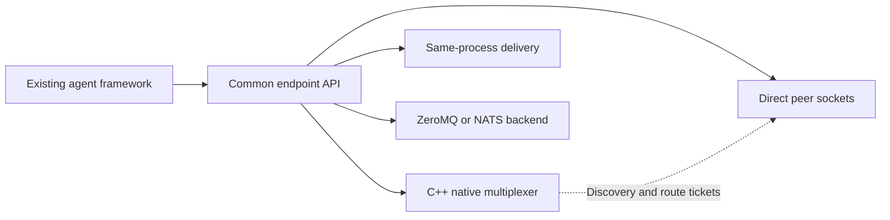

# SwarmWire 0.4

Research workflow, deep exploration, autoresearch with agents typically requires tens of thousands of agents. 
I expect that there would be swarms of agent running in the near future on a daily basis. 
To address this, this repo is a low level communication layer (plugin styled) to save latency and 
save time. Small save would propagate to big win.


A working communication layer for agent swarms: a **C++17 router**, a small Python
runtime, interchangeable transports, and adapters for existing agents. It moves
compact tasks and findings between workers without invoking a model to route them.

Use the same worker code with direct in-process delivery, authenticated peer
sockets, adaptive peer/broker routing, the native Unix/TCP broker, ZeroMQ, or NATS. Native transport is local to one machine; the NATS
adapter can connect to an existing remote NATS deployment.

[Measured comparisons](COMPARISON.md) · [Integration guide](INTEGRATION.md) ·
[Validation](VALIDATION.md) · [Raw benchmark data](comparison.json)

The 0.3 adaptive transport won all 45 matched warm median comparisons in the
recorded five-trial suite: Unix vs ZeroMQ IPC, and TCP vs ZeroMQ TCP/NATS. Local
Agent RTT was 28.21 µs; binary RPC was 25.83 µs. First-exchange exceptions and
all competing configurations are retained in the report. This is a measured
local result, not an unqualified worldwide fastest claim.

## Use without managing infrastructure

0.4 adds managed local startup. The default still uses in-process memory, which
needs no broker or compiler. Change configuration when you need local sockets:

```python
from swarmwire import Swarm, CallableAdapter

async with Swarm(backend='local') as swarm:
    await swarm.register('researcher', CallableAdapter(existing_agent.ainvoke))
    result = await swarm.request('researcher', {'question': 'explore'})
```

SwarmWire prepares the broker, starts a private Unix socket, checks readiness,
and cleans up the process/connections when the context closes. A parent-lifetime
pipe also stops the broker if its application crashes. There is no cloud account,
GPU allocation, global daemon, database, container service, or telemetry service.
Native binaries are included in platform wheels. An editable/source checkout
builds once with your existing C++17 compiler and caches the result privately.
No executables are downloaded at runtime.

Keep `Swarm()` in application code and choose with deployment configuration:

```sh
SWARMWIRE_BACKEND=local python app.py
SWARMWIRE_BACKEND=memory python app.py
SWARMWIRE_BACKEND=nats SWARMWIRE_NATS_URL=nats://server:4222 python app.py
```

For an application that starts multiple local worker processes, use one command:

```sh
python -m swarmwire run -- python app.py
```

The launcher shares a private broker's connection settings through the child's
environment. Descendant workers using `Swarm()` inherit them automatically. Your
application still owns worker scheduling; every process retains its existing agent
logic. Existing framework-internal handoffs are not intercepted automatically.

`backend='auto'` may select memory if local startup fails, before any workers run.
Use this only for workers in one process. Runtime failures fail pending requests;
there is no transparent replay of model calls or backend switch during a task.
The multi-process launcher requires native startup and never silently selects memory.

Check an installation without model calls: `python -m swarmwire check`.
Use `swarm.status()` or `await swarm.stats()` in your existing health endpoint.
Lifecycle events use Python's `swarmwire` logger; no background polling or
per-message logging is added, and connection tokens are omitted from status/logs.
See [deployment and rollback](INTEGRATION.md#managed-local-deployment).

The measured speed comparisons below are the recorded **0.3** baseline. Managed
startup adds startup work; 0.4 does not claim a new competitive benchmark win.
Ten thousand or one hundred thousand cross-machine agents remain outside this
local release's supported/validated deployment scope.

## Start an exploration

Python 3.10+. Install from this source directory:

```sh
python3 -m venv .venv
.venv/bin/python -m pip install -e '.[fast]'
```

For a compiler-free macOS arm64 or Ubuntu 22.04+ x86-64 install, use the wheel on the
[0.4 release page](https://github.com/Andy-Liu-the-Winner/swarmwire/releases/tag/v0.4.0).
The Linux wheel is built for Ubuntu's glibc/libstdc++ environment; it is not a
universal Linux/musl wheel. Source installations on other macOS/Linux systems
need a C++17 compiler. SwarmWire is not yet
published to PyPI; use this checkout or an explicit release file.

```python
import asyncio
from swarmwire import Swarm

async def researcher(payload, message):
    # Await your existing agent or provider here.
    return {'finding': payload['topic'].upper()}

async def main():
    async with Swarm() as swarm:
        await swarm.register('research-a', researcher)
        await swarm.register('research-b', researcher)
        async for name, result in swarm.explore({
            'research-a': {'topic': 'routing'},
            'research-b': {'topic': 'shared memory'},
        }):
            print(name, result)  # results arrive in completion order

asyncio.run(main())
```

The default is `MemoryBus`: workers share one process and event loop. For separate
processes on the same machine, build and run the native broker:

```sh
python3 -m swarmwire build
./bin/swarmwired --unix /tmp/swarmwire.sock
```

Then change the transport:

```python
from swarmwire import AdaptiveTransport, Swarm

async with Swarm(AdaptiveTransport(unix='/tmp/swarmwire.sock')) as swarm:
    # register workers or request an existing worker on that broker
    result = await swarm.request('remote-worker', {'topic': 'routing'})
```

A worker in another process connects independently:

```python
from swarmwire import Agent, PeerEndpoint

async with await PeerEndpoint.connect('remote-worker',
                                      unix='/tmp/swarmwire.sock') as endpoint:
    await Agent(endpoint).serve(researcher, concurrency=4)
```

Build on macOS/Linux with an existing C++17 compiler. The source implements
kqueue and epoll; 0.4 lifecycle/package tests passed on Ubuntu 22.04 and macOS
with Python 3.10/3.13. Existing Unix socket paths are never overwritten.
The broker also supports `--port 8765`, bound only to loopback.

## Integrate a framework

```python
from swarmwire import LangGraphAdapter, OpenAIAgentsAdapter, CrewAIAdapter

await swarm.register('graph', LangGraphAdapter(compiled_graph))
await swarm.register('sdk', OpenAIAgentsAdapter(openai_agent))  # payload {'input': ...}
await swarm.register('crew', CrewAIAdapter(crew))
```

Adapters call each framework's async entry point. Input/result mapping and
per-session configuration remain explicit. For any other async agent, use a
`(payload, message) -> dict` handler or `CallableAdapter(agent.ainvoke)`.
See [INTEGRATION.md](INTEGRATION.md) for state isolation, backend swaps and remote
workers. Install the framework SDK separately; importing SwarmWire does not load it.
A real compiled LangGraph was tested. CrewAI and OpenAI Agents adapters have
contract tests; live provider model requests were not run.

## Where the speed comes from



- The same-process path avoids sockets and transport copies.
- Peer links remove the broker hop from unicast traffic. The native broker issues
  single-use, destination-bound tickets that bind each connection to its sender.
- Adaptive routing switches dense fan-out/fan-in to native broker multiplexing,
  where batching can outperform individual peer sockets. The threshold is
  configurable; direct and routed policies are available explicitly.
- The protocol client handles frames directly in event callbacks, without a
  StreamReader task. Credits ride on outgoing messages when possible.
- Binary `RawRPC` avoids JSON and delivers replies straight to pending futures.
  Ready sends avoid redundant timers and coroutine scheduling.
- The native broker uses persistent sockets, binary routing headers and direct
  recipient lookup. It never parses or re-encodes the JSON body.
- Streaming sends remove the positive per-message broker acknowledgement.
  Application request/reply still verifies task completion.
- Native scatter/gather writes forward a shared body buffer; receiver credits
  keep inboxes bounded and preserve control-message progress.
- Deadlines use timeout contexts where available, avoiding an extra task per
  deadline. Optional uvloop and orjson reduce client overhead.
- Exploration tasks overlap and results become available as each completes.
- Bounded artifact stores allow workers to send references instead of repeated
  documents. Native clients verify SHA-256 integrity on load.

Model generation and provider internet latency remain separate costs. MCP and
model-selected tools are useful entry points; direct runtime messages provide
the lower-overhead coordination path.

## OpenAI, Anthropic and MCP tools

```python
from swarmwire import Agent, Client, Tools

client = await Client.connect('provider-worker', unix='/tmp/swarmwire.sock')
tools = Tools(Agent(client))
openai_tools = tools.openai()        # Responses function definitions
anthropic_tools = tools.anthropic()  # Messages tool definitions
```

Six tools: `relay_send`, `relay_send_batch`, `relay_receive`, `relay_store`,
`relay_load`, `relay_stats`. `execute_openai(response.output)` produces function
call outputs; `execute_anthropic(response.content)` produces tool result blocks.
See `examples/provider_tools.py`; credentials remain with your supplied SDK.

Install the MCP extra and give each stdio server a unique agent identity:

```sh
.venv/bin/python -m pip install -e '.[mcp]'
.venv/bin/python -m swarmwire mcp --agent unique-agent-id --unix /tmp/swarmwire.sock
```

Your MCP client launches that command with this source directory as its working
directory. Stdio is local; hosted HTTPS MCP integrations need an HTTP transport
or supported tunnel. The real official MCP SDK handshake and tool calls were tested.

## Delivery and limits

`NativeTransport` defaults to streaming (`acknowledged=False`). Its `send`
completes after a local stream write. Broker rejections close the connection and
fail pending requests. `Agent.request` completes only on a reply from the expected
recipient with the matching correlation ID. `Client.connect` defaults to
`acknowledged=True` for compatibility: each send waits for broker queue acceptance.
Neither acceptance nor a local write implies the worker completed its task.

All backends are ephemeral. Native disconnects/restarts can lose accepted work;
there is no native reconnect or retry. A timeout can occur after acceptance.
Applications must provide idempotency before retrying actions with side effects.
Cancelling a request stops the caller's wait; it does not cancel a remote model run.
Task handler failures return `RemoteError` and workers continue. Event/transport
failures stop `serve`; supervise those in your application.

Peer/Adaptive endpoints reserve a quarter of the inbox for routed traffic and
one slot per peer connection, plus a self slot when capacity > 2. Pending data
is bounded to 64 MiB per endpoint. Use capacity=512 for larger swarms. The
default adaptive threshold is 16 warm routes. Source/receiver connection setup
is excluded from warm benchmarks; first-exchange latency is reported separately.
`Swarm.register` preconnects routes during setup, and standalone endpoints expose
`preconnect`. The native control connection remains required for peer discovery
and artifacts; losing it closes that endpoint. Peer/Adaptive require the 0.3
broker. Public `Client` uses the fast protocol; `StreamClient` retains the old
stream interface. Fast clients were also tested against the 0.2 broker.

Native limits: 256 inbox messages by default (1–4096 configurable), 64 KiB Agent
envelopes, 1 MiB raw messages/artifacts, 4 MiB output queues per connection,
128 MiB globally, 4096 queued packets per recipient, 1024 connections, and a
64 MiB LRU artifact store. Evicted references can no longer be fetched.

The native broker is a single shard for a trusted local swarm. A shared connection
token can be supplied with `SWARMWIRE_TOKEN`; this is not per-agent authorization.
ZeroMQ uses trusted peer names; NATS authentication/TLS options pass through to
its client. NATS Core has its own buffering/loss behavior and is not JetStream.
Use an external artifact provider for distributed NATS/ZeroMQ workers.

## Reproduce the comparison

Use a dedicated benchmark environment; the tested direct dependencies are pinned
in `requirements-tested.txt`. Install an official `nats-server` executable
(version 2.15.1 in the recorded run), then:

```sh
.venv/bin/python -m pip install -r requirements-tested.txt
.venv/bin/python compare.py --nats-server /absolute/path/to/nats-server \
    --trials 5 --samples 500 --scatter-samples 50 --requests 4000 \
    --output comparison.json
NATS_SERVER_BINARY=/absolute/path/to/nats-server \
    .venv/bin/python -m unittest discover -s tests -v
```

The harness starts/stops its brokers, randomizes case order, warms every route,
verifies each result, and saves every trial. It measures Agent round trips at
64 B, 4 KiB and 32 KiB; 8/32/128-worker scatter/gather; and 1/32/128-producer
completed-request throughput. Separate
native SDK tests exercise SwarmWire RawRPC, direct pyzmq REQ/REP and nats-py
request/respond without our JSON Agent adapter. NATS uses the shared outer
deadline to avoid redundant SDK timers. Topology and acknowledgement differences are disclosed.

`benchmark.py` also measures native C++, Python and actual MCP layer overhead.
`benchmarks-*.json` record the earlier 0.1 run; use `comparison.json` for current
head-to-head claims. The prior 0.2 comparison is preserved in `history/v0.2/`.
Results are local microbenchmarks, not LLM speedups or
multi-machine service guarantees.

## Wire format

Big-endian frame: `uint32 remaining_length`, `uint8 opcode`, `uint32 request_id`,
`uint16 name_length`, name bytes, opaque body. HELLO=1, SEND=2, CREDIT=3,
STORE=4, LOAD=5, STATS=6, SEND_STREAM=7, SEND_STREAM_CREDIT=8, SEND_CREDIT=9, REGISTER_ROUTE=10,
OPEN_ROUTE=11, ACCEPT_ROUTE=12; ACK=128, DELIVERY=129, ERROR=130.

HELLO ACK returns capability bit 0 for piggybacked credits; old empty ACKs
remain supported. Opcodes 8/9 prefix the send body with a uint32 credit grant.
REGISTER_ROUTE publishes the local socket address. OPEN_ROUTE returns address
and a one-use ticket. ACCEPT_ROUTE verifies the ticket at its destination and
returns the registered source identity. Tickets expire after ten seconds.

Peer sockets use the same frame header: HELLO carries a ticket, ACK grants one
receive slot. Data names are empty; the verified connection supplies the sender.
DELIVERY_CREDIT=131 prefixes data with a uint32 grant. Binary RPC bodies have
`MAGIC=89 53 57 03`, uint8 kind (task=1/reply=2/error=3), uint64 correlation ID,
then application bytes. Its maximum application payload is 1 MiB minus 13 bytes.

HELLO: name=identity, body=`uint32 inbox_capacity + token_utf8`. SEND/STREAM:
name=recipient, body=payload. DELIVERY: name=sender. CREDIT: ID=0, empty name,
body=`uint32 consumed_count`, no ACK. STREAM has no positive ACK but can return
ERROR with its request ID. Other operations return ACK/ERROR with the original ID.
STORE/LOAD: name=SHA-256 hex; STORE carries bytes; LOAD returns bytes in ACK.
STATS returns JSON in ACK. Agent IDs are 1–64 ASCII letters, digits, `_`, `-`, `.`;
names are at most 128 bytes; frames over 1 MiB + 256 bytes close the connection.

MIT licensed. [Current products and design choices](LANDSCAPE.md).
